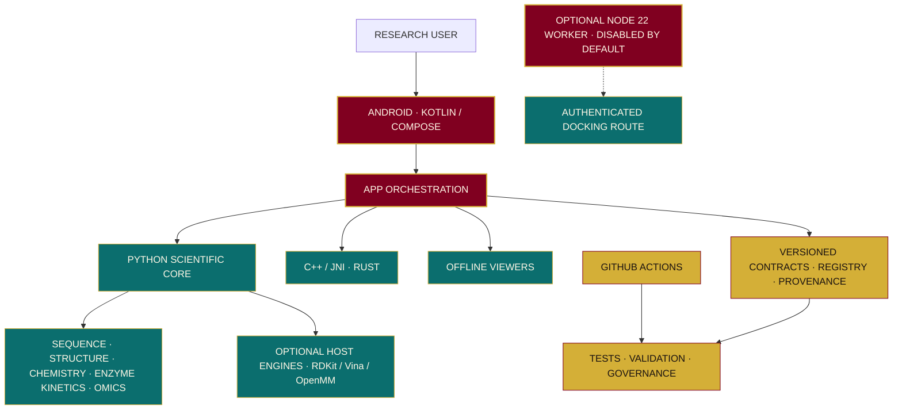

> **ALPHA BRANCH — REPOSITORY-AUDITED DESKTOP-FIRST DEVELOPMENT**  
> Molecularis is an installed scientific research application. Desktop applications for **Linux, Windows and macOS** are the first product delivery; Android and Apple iOS/iPadOS follow on shared scientific logic, project formats and contracts. A website/PWA is not the first product. The UI framework remains undecided pending a measured five-platform feasibility spike. Preferred core languages: **C++, Rust and Python**.  
> **Current registry audit:** 130 entries — 68 source-present tool declarations, 62 planned UI/settings/security entries, and **0 scientifically validated entries**. Source presence is not validation.  
> **Canonical planning:** [Master Plan](docs/MASTER_PLAN.md) · [Repository Baseline](docs/REPOSITORY_BASELINE.md) · [Capability Status](docs/CAPABILITY_STATUS.md) · [Full Capability Audit](docs/CAPABILITY_AUDIT.md) · [Legacy Requirements Traceability](docs/REQUIREMENTS_TRACEABILITY.md) · [Plan Retirement Map](docs/PLAN_RETIREMENT.md) · [Decisions](DECISIONS.md).

<!-- MOLECULARIS · BY ASSAYFLUX -->
<h1 align="center">MOLECULARIS</h1>

<strong>BY ASSAYFLUX SCIENTIFIC SYSTEMS</strong>

  

  

  

  

<!-- ═══════════════ REPOSITORY STATUS ═══════════════ -->

  
  
  
  
  
  
  
  

<!-- ═══════════════ CORE TECHNOLOGY ═══════════════ -->

  
  
  
  
  
  
  

<!-- ═══════════════ LEGACY ANDROID MIGRATION BASELINE ═══════════════ -->

  
  
  
  
  
  

<!-- ═══════════════ SCIENTIFIC ECOSYSTEM ═══════════════ -->

  
  
  
  
  
  
  

<!-- ═══════════════ QUALITY & REPRODUCIBILITY ═══════════════ -->

  
  
  
  
  
  
  
  

<!-- ═══════════════ PROJECT IDENTITY ═══════════════ -->

  
  
  
  
  

## RELEASE DIRECTION

The previous Android v0.1.0/v0.1.1 release sequence is historical and is not the current product delivery plan. The active delivery sequence is defined in the [repository-first Master Plan](docs/MASTER_PLAN.md): exact baseline and migration audit, cross-platform framework feasibility, shared contracts/project foundation, installed desktop application, desktop scientific vertical slices, compute extensions, mobile applications, and institutional readiness. No future release is claimed complete until its implementation and evidence gates pass.

## ABOUT
**Molecularis** is an open-source scientific research workbench from **AssayFlux Scientific Systems**. It combines an Android-native, offline-first application with a Python research core and selected C++ and Rust components. Sequence, structure, chemistry, kinetics and omics foundations sit behind versioned contracts and a capability registry.

The project prioritises reproducibility, provenance, bounded inputs and explicit limitations. The current repository is a research-engineering prototype with selected scientific source implementations; it is not a completed cross-platform application or clinically validated platform. See the [Molecularis identity migration and compatibility contract](docs/brand-migration.md) for retained legacy identifiers and integration aliases.

<table>
  <tr>
    <td align="center" width="33%"> <strong>RESEARCH</strong> Modular scientific workflows with clearly scoped capabilities.</td>
    <td align="center" width="33%"> <strong>REPRODUCIBILITY</strong> Inputs, parameters, versions, units and provenance are preserved.</td>
    <td align="center" width="33%"> <strong>EVIDENCE</strong> Implementation, tests, independent validation and device verification stay separate.</td>
  </tr>
</table>

## SCIENTIFIC CAPABILITIES
<table>
  <tr>
    <td align="center" width="50%"> <strong>SEQUENCE &amp; GENOMICS</strong> FASTA/FASTQ, alignment, k-mer utilities, SAM/BAM/VCF foundations and variant normalisation.</td>
    <td align="center" width="50%"> <strong>STRUCTURAL BIOLOGY</strong> PDB/mmCIF parsing, contacts, RMSD and bounded structure-analysis foundations.</td>
  </tr>
  <tr>
    <td align="center"> <strong>CHEMISTRY &amp; DOCKING</strong> Molecular graph and SMILES/MOLBLOCK utilities; optional RDKit and AutoDock Vina adapters.</td>
    <td align="center"> <strong>MOLECULAR DYNAMICS</strong> Optional OpenMM runner with explicit setup and force-field limitations.</td>
  </tr>
  <tr>
    <td align="center"> <strong>ENZYME KINETICS &amp; PK/PD</strong> Michaelis–Menten models and exploratory pharmacokinetic/pharmacodynamic utilities.</td>
    <td align="center"> <strong>OMICS &amp; PGx</strong> Exploratory statistics, synthetic cohort utilities and research-only pharmacogenomics parsing.</td>
  </tr>
  <tr>
    <td align="center"> <strong>ANDROID WORKBENCH</strong> Kotlin and Jetpack Compose foundation with offline-first constraints.</td>
    <td align="center"> <strong>GOVERNANCE &amp; PROVENANCE</strong> Capability registry, JSON Schema contracts, source inventory and evidence controls.</td>
  </tr>
</table>

  

## DESIGN PREVIEWS
<table>
  <tr>
    <td align="center" width="50%">
      
       <strong>DASHBOARD · DESIGN REFERENCE</strong>
    </td>
    <td align="center" width="50%">
      
       <strong>LOGIN · DESIGN REFERENCE</strong>
    </td>
  </tr>
</table>

## STATUS AND PROGRESS
| TRACK | SCOPE | CURRENT SOFTWARE POSITION | OPEN GATE |
|:---:|---|---|---|
| **R** | Research platform | **SOFTWARE AUDIT CLOSED** | Device, independent scientific, licensing and release evidence remain. |
| **S** | Structure, sequence and discovery | **SOFTWARE SCOPE CLOSED** | Independent references, licensed resources/models and device evidence remain. |
| **I** | In-silico laboratory | **SOFTWARE AUDIT CLOSED** | Scientific benchmarks, licensing, secure-node and device evidence remain. |
| **P** | Precision Medicine (PGx First) | **SOFTWARE FOUNDATION CLOSED** | D-025 opens owner-authorized research testing within the declared institutional approval; the approval record is pending attachment/verification. Clinical deployment and clinical decision support remain gated. |
| **G** | Governance, assurance and publication readiness | **HISTORICAL G0–G7 ENGINEERING AUDIT CLOSED** | The 18 Nov baseline commit `83df8e7` had a Python foundation failure in its exact-head run; this correction requires a fresh exact-head CI result. Overall acceptance also requires independent reviews, complete SBOM/licensing, device checks, owner policy acceptance and operating exercises. |
| **U** | User interface and experience | **STARTED — STEP 1 BASE IMPLEMENTATION** | Owner V1 monochrome UI specification adopted (D-024); U0–U3 remain partial baseline; U4–U6 remain dependency-gated. Step 2 audit not yet run. |

| ENGINEERING AREA | POSITION |
|---|---|
| BUILD | GitHub Actions CI is configured. Read the live badge above for the current head. |
| TESTS | pytest and Android JVM test tasks are defined in CI. |
| COVERAGE | No verified coverage percentage is published. |
| DEPLOYMENT | No production deployment or signed public release. CI builds debug artifacts only. |

## TECHNOLOGY STACK

  

| LAYER | TECHNOLOGY |
|---|---|
| ANDROID | Kotlin, Jetpack Compose, AndroidX, Gradle, Chaquopy |
| PYTHON | Python 3.10+, setuptools, pytest, Ruff, mypy |
| NATIVE | C++17, JNI/NDK, Rust |
| OPTIONAL ENGINES | RDKit, AutoDock Vina 1.2.7, OpenMM 8.6.1 |
| VIEWER | HTML5, CSS, JavaScript, Android WebView |
| WORKER | Node.js 22+, dependency-free HTTP/TLS worker |
| CONTRACTS | JSON Schema, YAML, SPDX source inventory |

## SYSTEM ARCHITECTURE

## NEXT GATES
| TRACK | NEXT REQUIRED WORK |
|:---:|---|
| **P** | Patient-data research testing is owner-authorized only within the declared institutional approval under D-025; its approval record remains pending attachment/verification. Clinical PGx interpretation, diagnosis, treatment/dosing recommendations and clinical deployment remain unauthorized. |
| **G** | Finish the exact-head G0–G7 engineering audit, then hand the sequence to U. External assurance and operational evidence remain carry-forward gates. |
| **U** | Resume sequential implementation only after G's two-step gate is assessed. Retain partial U0–U3 as baseline, not as accepted completion. |
| **CROSS-CUTTING** | Independent scientific benchmarks; data/model/dependency licensing and SBOM coverage; physical Android, offline, accessibility and recovery verification; real application demo. |

## CONTRIBUTION AND LICENSING
1. Read `NORTH_STAR.md`, `ROADMAP.md`, `DECISIONS.md` and `CONTRIBUTING.md`.
2. Follow `docs/ENGINEERING_INTEGRATION_STANDARD.md` and the active sequential track gate.
3. Add or update tests, schemas, provenance and licensing evidence with implementation.
4. Report checks run, checks not run, limitations and remaining gates. Never imply scientific or device validation without evidence.

**License:** Apache License 2.0. Third-party dependencies, engines, datasets, models, fonts and visual assets may have separate terms; review upstream conditions before bundling or redistribution.

## BRAND IDENTITY

  

## THE JOURNEYS

  

 

  

  

  

  

  

  

  

  

  

  

  

  

## CULTURAL REPRESENTATIONS

  

  

  

  

  

  

  

  

  

  

