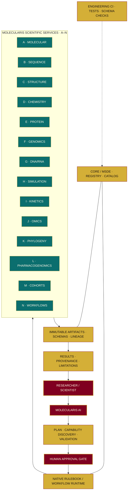

<!-- MOLECULARIS · BY ASSAYFLUX -->

<p align="center">
  
</p>

<p align="center">
  
</p>

<p align="center">
  
</p>

<p align="center">
  
</p>

<p align="center">
  <a href="https://github.com/AssayFlux/Molecularis/blob/CORE/LICENSE"></a>
  <a href="https://github.com/AssayFlux/Molecularis/actions/workflows/ci.yml"></a>
  <a href="https://github.com/AssayFlux/Molecularis/stargazers"></a>
  <a href="https://github.com/AssayFlux/Molecularis/forks"></a>
  <a href="https://github.com/AssayFlux/Molecularis/issues"></a>
  <a href="https://github.com/AssayFlux/Molecularis/pulls"></a>
  <a href="https://github.com/AssayFlux/Molecularis/commits/CORE"></a>
</p>

<p align="center">
  
  
  
  
  
</p>

---

## THE IDEA

**Molecularis** is a Molecularis-native scientific computing system designed to connect molecular science, sequence analysis, structural biology, chemistry, protein science, genomics, DNA/RNA, simulation, kinetics, omics, phylogenetics, pharmacogenomics, cohorts and reproducible workflows.

The central idea is simple: scientific capabilities should not remain isolated tools. They should become explicit, versioned, testable services that can exchange typed artifacts, follow machine-readable Rulebooks and preserve the evidence behind every result.

Molecularis is being engineered as a coherent research system—not as a collection of unrelated wrappers.

<table>
  <tr>
    <td align="center" width="33%">
      <br>
      <strong>CONNECTED SCIENCE</strong><br>
      <sub>Domain services with shared contracts and explicit capability boundaries.</sub>
    </td>
    <td align="center" width="33%">
      <br>
      <strong>REPRODUCIBILITY</strong><br>
      <sub>Immutable artifacts, lineage, parameters and execution records.</sub>
    </td>
    <td align="center" width="33%">
      <br>
      <strong>SCIENTIFIC INTEGRITY</strong><br>
      <sub>Validation evidence and limitations remain visible—not implied.</sub>
    </td>
  </tr>
</table>

## THE NORTH STAR

> Every scientific result should be traceable to its inputs, method, parameters, software version, reference data and validation evidence.

Molecularis aims to make complex research workflows inspectable and reproducible. It distinguishes implementation from validation, prediction from measurement, and successful execution from scientific correctness.

Read the [North Star](docs/NORTH_STAR.md) and [Scientific Validation Standard](docs/SCIENTIFIC_VALIDATION_STANDARD.md).

## MOLECULARIS AI — THE INTELLIGENCE LAYER

<p align="center">
  
</p>

Molecularis AI is designed to translate a research request into a validated execution plan over the native A–N service catalog.

**Intended operating loop**

1. **Understand** — receive the research objective, constraints and supplied input artifacts.
2. **Discover** — inspect the capabilities registered by Molecularis services.
3. **Plan** — propose a versioned Workflow document using available capabilities.
4. **Validate** — check the plan against workflow contracts, registered operations, resource limits and artifact references.
5. **Approve** — require explicit human approval before execution.
6. **Execute** — delegate computation to Molecularis services and the native Rulebook runtime.
7. **Inspect** — collect run evidence, output artifacts, lineage and execution status.
8. **Report** — present results with methods, provenance, limitations and unresolved questions.

The AI layer coordinates scientific engines; it is not a replacement for them. Model-generated content is treated as untrusted structured input, not executable code.

**Current implementation:** a model-agnostic planning and approval framework exists in `python/molecularis/ai.py`; `create_full_platform()` bootstraps the A–N service catalog. A provider adapter, configured model credentials, robust real-world cross-service artifact compatibility and independent AI safety evaluation remain open acceptance work. No hosted model is bundled or silently assumed.

Read [Molecularis AI — Engine](services/ai/ENGINE.md), [Rulebook](services/ai/RULEBOOK.md) and [Acceptance criteria](services/ai/ACCEPTANCE.md).

## SCIENTIFIC SERVICE SYSTEM · A–N

| ID | SERVICE | SCIENTIFIC SCOPE |
|:---:|---|---|
| **A** | Molecular | Molecular entities, representations, descriptors and molecular operations. |
| **B** | Sequence | Biological sequence parsing, transformations, alignment and analysis. |
| **C** | Structure | Molecular structure representation, parsing and structural analysis. |
| **D** | Chemistry | Chemical representations, molecular graphs and chemistry operations. |
| **E** | Protein | Protein sequence and protein-science analysis foundations. |
| **F** | Genomics | Read/alignment and variant-oriented genomics workflows. |
| **G** | DNA/RNA | Nucleic-acid design, analysis and domain-specific rule packages. |
| **H** | Simulation | Molecular simulation execution and simulation-oriented workflows. |
| **I** | Kinetics | Reaction networks, kinetic models and numerical integration. |
| **J** | Omics | Feature matrices, normalisation and exploratory multi-omics analysis. |
| **K** | Phylogeny | Sequence-derived distance, tree construction and bootstrap support. |
| **L** | Pharmacogenomics | Provenance-pinned allele resources and conservative genotype matching foundations. |
| **M** | Cohorts | Synthetic cohort operations, descriptive summaries and privacy-aware aggregation foundations. |
| **N** | Workflows | DAG orchestration, registered capabilities and reproducible workflow execution. |

Service presence or registration is not proof of scientific validation. Optional external engines, models, reference datasets and their licenses must be evaluated in the deployment environment.

See the [A–N Service Roadmap](docs/SERVICE_ROADMAP.md) and [Service Status](docs/SERVICE_STATUS.md).

## PLATFORM FOUNDATION

| FOUNDATION | RESPONSIBILITY |
|---|---|
| **Core / MSDE** | Shared scientific data contracts, immutable artifacts, metadata catalog and provenance. |
| **Capability Registry** | Discoverable, versioned operations exposed by domain services. |
| **Rulebook Runtime** | Validated workflow DAGs, execution policy, resource bounds and run evidence. |
| **Artifact Store** | Content-addressed data, integrity checks and parent/lineage relationships. |
| **Workflow Engine** | Dependency ordering, operation dispatch and success/failure recording. |
| **Service Runtime** | Lifecycle and bounded execution for the local reference platform. |
| **Molecularis AI** | Research-request planning, capability selection and approval-gated orchestration. |

### SYSTEM ARCHITECTURE



## REPOSITORY MAP

| PATH | PURPOSE |
|---|---|
| `CORE/` | Shared Core/MSDE architecture and implementation. |
| `services/<service>/` | Domain-owned engine, runtime, Rulebook, schemas and service metadata. |
| `services/ai/` | AI engine specification, orchestration Rulebook and acceptance gates. |
| `python/molecularis/platform/` | Local reference runtime, artifact store, catalog, registry and workflow executor. |
| `python/molecularis/ai.py` | Model-agnostic AI planning and approval-gated execution interface. |
| `python/molecularis/bootstrap.py` | Full A–N platform construction and service registration. |
| `python/kinetics/` | Retained scientific implementation pending ongoing audit and migration. |
| `api/` · `schemas/` | Versioned API and data contracts. |
| `capabilities/` | Capability inventory and registration metadata. |
| `data/` · `validation/` | Reference metadata and validation assets. |
| `remote-node/` | Remote execution component and its boundary. |
| `scripts/` · `tests/` | Engineering checks, fixtures and automated tests. |
| `Assets/` | Molecularis and AssayFlux identity and visual assets. |

## CURRENT ENGINEERING POSITION

The repository contains the A–N service foundations and a local Core/MSDE reference implementation. The platform includes content-addressed SHA-256 artifact storage, a SQLite WAL catalog, lineage, bounded streaming, integrity auditing, metadata lookup, capability registration and Rulebook DAG execution.

A full-platform bootstrap now registers the fourteen service packages. The initial Molecularis AI planning layer is implemented and requires approval before workflow execution.

**Latest observed engineering CI:** [run #44901363429](https://github.com/AssayFlux/Molecularis/actions/runs/44901363429) completed successfully on commit `2b6eced852fb049a81f6b087bb94e5e946047750`. The prior fully reported baseline recorded Core 746 passed / 12 skipped; Chemistry 754 / 4; Sequence 749 / 9; Genomics 747 / 11. See the linked run for the exact-head result and job details.

### WHAT IS NOT YET CLAIMED

- No independent university-level scientific validation has been completed or asserted here.
- Real end-to-end scientific chains across all services still require compatibility and integration evidence.
- The AI framework does not include a configured LLM provider, API key or hosted inference deployment.
- The local reference runtime is not a distributed production platform; OS-level sandboxing, robust recovery certification and multi-process execution remain open.
- Optional scientific engines and models must be separately installed, configured, licensed and validated.
- No clinical validation, diagnostic capability or treatment recommendation is claimed.

## DEVELOPMENT

**Requirements:** Python 3.10 or newer.

```bash
python -m pip install -r requirements-dev.txt
python -m pip install -e .
pytest
python scripts/check_registry.py
```

For the full engineering process, use the repository's governing documents rather than bypassing service gates.

## GOVERNANCE, ROADMAP AND ENGINEERING RULES

- [North Star](docs/NORTH_STAR.md)
- [Master Development Plan](docs/MASTER_DEVELOPMENT_PLAN.md)
- [A–N Service Roadmap](docs/SERVICE_ROADMAP.md)
- [Master Engineering Rulebook](MASTER_ENGINEERING_RULEBOOK.md)
- [Future Architecture](docs/FUTURE_ARCHITECTURE.md)
- [Service Status](docs/SERVICE_STATUS.md)
- [Work Backlog](docs/WORK_BACKLOG.md)
- [Continuous Work Protocol](docs/CONTINUOUS_WORK_PROTOCOL.md)
- [Scientific Validation Standard](docs/SCIENTIFIC_VALIDATION_STANDARD.md)
- [MSDE Architecture](CORE/data-engine/README.md)
- [Security Policy](SECURITY.md)

## RESEARCH COLLABORATION

Molecularis is intended to grow through collaboration among researchers, computational scientists, software engineers and academic institutions. Contributions should strengthen the scientific method, contracts, provenance, testing, documentation or validation evidence—not merely increase the number of features.

When contributing:

1. Read the North Star, roadmap, engineering rulebook and active service specification.
2. Preserve service boundaries and versioned artifact contracts.
3. Include tests, schemas, provenance and resource constraints with implementation.
4. Record optional dependencies, data/model sources and their licenses.
5. State exactly what was tested, what was not tested and what remains uncertain.
6. Never describe software tests as proof of scientific correctness.

## LICENSE AND ATTRIBUTION

Molecularis is distributed under the repository's [LICENSE](LICENSE). Third-party libraries, scientific engines, datasets, pretrained models, fonts and visual assets may carry separate licenses and terms. Review upstream conditions before redistribution or bundling.

<p align="center">
  
</p>

<p align="center">
  
</p>

<p align="center">
  
</p>

<p align="center">
  
</p>

<p align="center">
  
</p>
